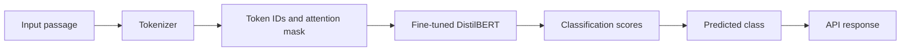
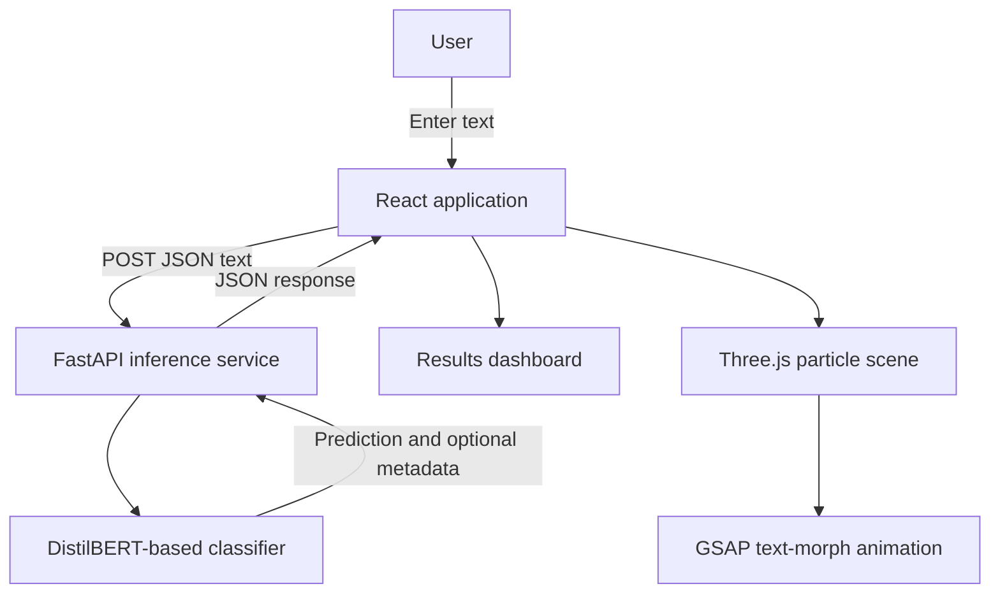

# BOT OR NOT

### AI-generated text detection meets interactive 3D visualization.

**BOT OR NOT** is an AI-powered text classification experience that explores a question becoming increasingly important in the age of generative AI: **Was this text written by a human, or generated by an AI system?**

The project combines a **DistilBERT-based text classification approach**, a **FastAPI inference service**, and a cinematic web interface built with **React, Three.js, and GSAP**. Users submit a passage of text, receive a predicted classification, and explore supporting information through a dedicated analysis dashboard. At the center of the experience is **VORA — Visionary Orb Reasoning Assistant**, a real-time 3D particle visualization that transforms its appearance to reveal the model's prediction.

BOT OR NOT is both an applied natural language processing project and an exploration of how machine learning results can be communicated through interactive, visually engaging software.

**Repository:** [github.com/HIRGON7/Bot-Or-Not](https://github.com/HIRGON7/Bot-Or-Not)  
**Project interface:** VORA (Visionary Orb Reasoning Assistant)  
**Primary focus:** Natural language processing, text classification, machine learning integration, interactive web development

---

## Table of contents

1. [Project overview](#project-overview)
2. [The idea behind BOT OR NOT](#the-idea-behind-bot-or-not)
3. [Meet VORA](#meet-vora)
4. [How the application works](#how-the-application-works)
5. [Machine learning approach](#machine-learning-approach)
6. [Training approach and experimentation](#training-approach-and-experimentation)
7. [The 3D visualization system](#the-3d-visualization-system)
8. [Analysis dashboard](#analysis-dashboard)
9. [System architecture](#system-architecture)
10. [Technology stack](#technology-stack)
11. [Frontend implementation](#frontend-implementation)
12. [API integration and response format](#api-integration-and-response-format)
13. [Project structure](#project-structure)
14. [Running the project locally](#running-the-project-locally)
15. [An example user journey](#an-example-user-journey)
16. [Design and engineering decisions](#design-and-engineering-decisions)
17. [Understanding the predictions](#understanding-the-predictions)
18. [Project scope](#project-scope)
19. [Author](#author)

---

## Project overview

Most text classification systems are encountered as simple forms: paste some text, click a button, and read a label. BOT OR NOT takes the same essential machine learning task and makes the entire interaction more expressive.

The application has two connected experiences:

- **An interactive classification interface**, where users enter text and submit it for AI-versus-human analysis.
- **A detailed results experience**, where the returned classification can be explored alongside confidence values, class probabilities, text statistics, and token information when provided by the inference service.

A third element brings them together: an animated, particle-based visual assistant that transitions from a spherical form into text representing the prediction.

The frontend is responsible for collecting input, communicating with the model API, visualizing the prediction, and presenting its accompanying information. The machine learning inference takes place on a separate backend service, allowing the interface and the model to operate as distinct parts of the system.

### What users can do

- Enter a passage of text for analysis.
- Submit that text to a machine learning inference API.
- View a predicted **AI** or **human** classification.
- See the 3D particle visualization transform to display the result.
- Explore confidence and class-probability fields when returned by the backend.
- Review supplementary output such as token counts, token lists, and linguistic statistics when available.
- Move from the visual introduction to the more detailed analysis section without leaving the page.

---

## The idea behind BOT OR NOT

Large language models have changed how people produce written content. Emails, essays, articles, summaries, and many other types of writing can now be generated or revised using AI tools. This creates an interesting natural language processing problem: **Can patterns in a passage of text help a model estimate whether it originated from a human writer or an AI text generator?**

BOT OR NOT approaches that question as a **binary text classification task**. Rather than attempting to discover an author's identity, the model estimates which of two broad categories better matches the input:

| Class | Interpretation |
| --- | --- |
| **Human** | The classifier assigns the passage to the human-written category. |
| **AI** | The classifier assigns the passage to the AI-generated category. |

The technical objective is to turn an unstructured string of text into a structured prediction that can be displayed and explored by an application.

The experience is designed around three ideas:

1. **Apply NLP to a meaningful classification problem.** Text is processed by a transformer-based model rather than classified using simple keyword rules.
2. **Expose the result in an understandable format.** The interface separates the predicted label from additional metadata such as probabilities and word-level statistics.
3. **Make the interaction memorable.** A 3D particle system transforms a model response into an animated visual event rather than a plain notification.

---

## Meet VORA

**VORA** stands for **Visionary Orb Reasoning Assistant**. It is the visual identity of the BOT OR NOT interface.

VORA begins as a glowing sphere constructed from thousands of individually positioned particles. While the user enters text, the sphere provides a continuous ambient animation. When a prediction is returned by the backend, the particle positions are recalculated and smoothly animated into a text-shaped arrangement that represents the classification.

This gives the application a visual language of its own:

- **Before analysis:** a rotating particle sphere represents the interface's idle state.
- **During analysis:** the interface communicates that classification is in progress.
- **After analysis:** the sphere morphs into the predicted label.
- **Below the visualization:** a separate dashboard presents the structured result in more depth.

VORA is a **frontend visualization**, not a separate language model or autonomous reasoning agent. The classification originates from the backend model; VORA makes that output interactive and visible.

---

## How the application works

The user-facing flow is organized into a small number of steps.

### 1. Enter text

A user types a passage into the input field displayed over the 3D scene. The frontend stores the current input in React state.

### 2. Submit for classification

When the user submits the form, the interface trims the text, enters a loading state, and sends an HTTP `POST` request to the endpoint configured through the `VITE_API_URL` environment variable.

The request body follows a simple JSON structure:

```json
{
  "text": "A passage of text to examine."
}
```

### 3. Receive the model response

The inference service returns a JSON response containing the predicted class and, depending on the API output, additional information such as scores, counts, and token data.

### 4. Animate the predicted class

The frontend extracts the predicted label from the returned data and passes it to the Three.js visualization. GSAP interpolates the particle positions to form the classification text.

### 5. Explore the explanation panel

The React results dashboard receives the same response and renders the fields supplied by the backend. Users can scroll from the hero visualization to the analysis section to inspect the prediction in a more structured format.

This division between **inference**, **visual feedback**, and **detailed presentation** is central to the design.

---

## Machine learning approach

At the heart of the broader BOT OR NOT project is a **DistilBERT-based binary text classifier**.

### Why DistilBERT?

DistilBERT is a distilled version of BERT, a transformer architecture designed to produce contextual representations of language. Its smaller architecture makes it an attractive starting point for applications that need the language understanding capabilities of a transformer while keeping inference requirements more manageable.

Unlike a simple bag-of-words classifier, a transformer processes tokens in context. The representation of a word can change depending on the surrounding words and the overall sequence. That contextual information is useful for classification tasks in which sentence structure, wording patterns, and relationships between tokens may contribute to a prediction.

### Conceptual inference pipeline



**Tokenization.** The input passage is converted into the token representation expected by the model. Transformer tokenizers may split words into smaller subword units, helping them represent a large vocabulary using a fixed set of tokens.

**Contextual encoding.** DistilBERT processes the token sequence through transformer layers and produces representations informed by the relationships between tokens.

**Classification.** A classification layer uses the model representation to produce scores for the two classes. The inference pipeline converts those scores into a predicted label and can expose numerical values for display by the frontend.

**Delivery.** The backend wraps the outcome in a JSON response, which the web application can consume without running the transformer directly in the browser.

The website does **not** perform text classification using JavaScript rules. Its role is to act as a client for the inference service.

---

## Training approach and experimentation

The BOT OR NOT model work involved fine-tuning DistilBERT for the distinction between human-written and AI-generated text. The development experiment used a large labeled text collection, allowing the model to learn a binary classification objective from examples of both classes.

### Experiment configuration

| Item | Configuration |
| --- | --- |
| Task | Binary text classification |
| Model family | DistilBERT |
| Classes | Human-written / AI-generated |
| Training data | Approximately 1.25 million text examples in the development dataset |
| Training epochs | 2 |
| Learning rate | `2e-5` |
| Batch size | 16 |
| Model deployment style | Inference service consumed by the React application |

These values describe the model-development experiment associated with the project. This repository contains the **web interface**, while model inference is accessed through a backend API.

The training workflow can be understood as a sequence of standard supervised learning stages:

1. **Prepare labeled examples** for the two target categories.
2. **Tokenize the text** using the preprocessing format expected by DistilBERT.
3. **Fine-tune the classifier** by comparing predicted outputs against training labels and updating model parameters.
4. **Evaluate predictions** on examples not used to update the model, using classification metrics and error analysis.
5. **Expose inference** through an API so the model can be accessed from the web application.

In binary classification work, evaluation typically considers more than overall accuracy. Precision and recall describe different kinds of classification performance, while F1 summarizes their balance. A confusion matrix illustrates how the model distributes correct and incorrect predictions across both classes.

**No numerical evaluation score is claimed in this README** because a specific, verified evaluation report is not presented here. The project's main public demonstration is the integration of transformer-based text classification with an interactive web experience.

---

## The 3D visualization system

The real-time particle system is one of BOT OR NOT's defining engineering features. It is implemented in [`src/component/morph.jsx`](src/component/morph.jsx) with **Three.js** and **GSAP**.

### A sphere made from 12,000 particles

The animation creates **12,000 points** and places them around a sphere using a deterministic spherical distribution, with small random offsets to create a more organic appearance.

Instead of creating 12,000 individual mesh objects, the application uses a single `THREE.BufferGeometry` backed by typed arrays:

- A `Float32Array` holds particle positions as `x`, `y`, and `z` values.
- A second array stores particle colors.
- `THREE.Points` renders the geometry using a `THREE.PointsMaterial`.
- Additive blending and per-vertex colors produce the luminous particle effect.

Using one point cloud is a practical choice for visualizing thousands of particles without the overhead of maintaining thousands of separate scene objects.

### Generating text-shaped target positions

The morph effect uses the browser's canvas drawing capabilities to turn the predicted label into a set of destination coordinates.

The procedure is conceptually straightforward:

1. Draw the prediction text onto an off-screen 2D canvas.
2. Read the resulting pixel data.
3. Sample visible pixels to produce a collection of 2D positions.
4. Convert those positions into coordinates within the Three.js scene.
5. Assign particles to the text positions; distribute the remaining particles around the outer scene.

This approach makes it possible for the same visualization to form different labels dynamically. The text is generated from the model output rather than being a hardcoded image.

### Smooth interpolation with GSAP

GSAP animates particle positions from their current arrangement to the target shape. The source code uses a **2.4-second** transition with a `power2.inOut` easing curve.

During the animation, each particle moves between its initial and destination coordinates. The geometry's position buffer is marked for updating so Three.js can draw the new arrangement on each frame.

The visualization also includes a continuous render loop, gentle sphere rotation, a perspective camera, and resize handling to adapt to the available viewport.

### React lifecycle integration

The Three.js scene is initialized inside a React effect. On cleanup, the component cancels the animation frame, removes the resize listener, stops the active position tween, and disposes of the renderer and particle geometry. This keeps the 3D lifecycle coordinated with the React component lifecycle.

---

## Analysis dashboard

The second half of BOT OR NOT is a structured results panel implemented in [`src/App.jsx`](src/App.jsx). The dashboard is designed to make the API response more explorable than a single AI/Human label.

### Prediction

The primary result shows the class predicted by the model, styled as a prominent heading.

### Confidence and class probabilities

When available, the frontend shows the returned **confidence**, **AI probability**, and **human probability** values. A formatting helper supports score values expressed either as proportions (such as `0.82`) or percentages (such as `82`).

### Text and token information

Depending on the data supplied by the backend, the interface can display:

| Field | What the dashboard displays |
| --- | --- |
| `token_count` | Number of tokens reported by the service |
| `tokens` | A list of tokens, with the first 100 displayed |
| `top_tokens` | A separate list of token items, with the first 60 displayed |
| `explanation` | An explanatory text field returned by the service |
| `linguistic_analysis.sentence_count` | Number of sentences |
| `linguistic_analysis.word_count` | Number of words |
| `linguistic_analysis.unique_word_count` | Number of unique words |

The dashboard renders these sections **conditionally**: fields appear when the API includes them. This supports responses with different levels of detail while keeping the same frontend experience.

The visual hierarchy separates the most important result from its supplementary information, allowing the interface to work both as a quick classifier and as a more detailed inspection tool.

---

## System architecture

BOT OR NOT uses a separated frontend–backend architecture. The browser handles interaction and visualization; the model service handles machine learning inference.



### Frontend responsibilities

- Present and capture the user's text input.
- Track input, loading, result, and error state in React.
- Send asynchronous requests to the inference API.
- Parse returned prediction data and supporting metadata.
- Update the analysis dashboard.
- Trigger the visual transformation of VORA.

### Backend responsibilities

- Receive the submitted text.
- Prepare the input for the model.
- Execute the trained classifier.
- Return the prediction and any supporting fields in JSON format.

This separation keeps machine learning inference independent from the visual presentation. It also makes the UI easier to adapt to a compatible classification service without rewriting the Three.js animation system.

---

## Technology stack

| Technology | Role in BOT OR NOT |
| --- | --- |
| **Python / DistilBERT** | Transformer-based NLP classification work |
| **FastAPI** | Model inference API used by the broader system |
| **React 19** | Component structure, state management, and interactive rendering |
| **Vite 8** | Frontend development server and production builds |
| **JavaScript** | Browser interaction, API calls, and UI logic |
| **Three.js** | 3D scene, particle geometry, camera, materials, and rendering |
| **GSAP** | Interpolation and animated transitions between particle formations |
| **CSS** | Responsive layouts, typography, styling, and dashboard presentation |
| **JSON / Fetch API** | Communication between the frontend and inference service |

The repository's `package.json` declares the JavaScript dependencies. Python model training and inference are separate from the browser-side source represented in this repository.

---

## Frontend implementation

The application uses a small, focused React component structure.

### `src/App.jsx`

This is the top-level interface component. It coordinates the overall experience and stores three important pieces of state:

- `analysisResult`: the latest structured response from the API.
- `analysisError`: an error message associated with the most recent request.
- `isAnalyzing`: whether a submission is currently being processed.

The component renders the visual classification section, the connecting scroll interaction, and the detailed results dashboard. It receives events from the particle component through callback props.

### `src/component/morph.jsx`

This component contains the animated 3D scene and the text submission form. It is responsible for rendering the sphere, obtaining a response from the configured endpoint, and initiating the morph into the predicted label.

It communicates back to `App.jsx` using three callback props:

| Callback | Role |
| --- | --- |
| `onLoading` | Updates the parent component's loading state |
| `onResult` | Passes the API response to the results dashboard |
| `onError` | Communicates an API error to the parent component |

The component also accepts several conventional prediction field names (`prediction`, `predicted_label`, `label`, or `result`) when extracting the label for the animation.

### `src/App.css` and `src/styles/Morph.css`

These stylesheets define the application's full-screen presentation, particle-canvas placement, input controls, analysis cards, dashboard grid, and responsive behavior.

The visual design emphasizes a dark background, luminous particles, restrained violet accents, and high-contrast information panels. The goal is to make the AI analysis feel immersive without removing the practical utility of the results dashboard.

---

## API integration and response format

The frontend reads the prediction endpoint from the environment variable `VITE_API_URL`:

```js
const API_URL = import.meta.env.VITE_API_URL;
```

When a user submits text, the browser sends an HTTP `POST` request with a JSON body:

```http
POST /predict
Content-Type: application/json
```

```json
{
  "text": "Technology is changing the way we write and communicate."
}
```

A compatible inference service returns at least a prediction label. It may also return additional information consumed by the results dashboard.

### Example response

The following is an **illustrative response format**, not a recorded model prediction:

```json
{
  "prediction": "AI",
  "confidence": 0.87,
  "ai_probability": 0.87,
  "human_probability": 0.13,
  "token_count": 12,
  "explanation": "Example explanatory text from the inference service.",
  "linguistic_analysis": {
    "sentence_count": 1,
    "word_count": 11,
    "unique_word_count": 11
  },
  "tokens": ["Technology", "is", "changing"],
  "top_tokens": ["Technology", "changing"]
}
```

The dashboard reads known fields from the JSON object and displays the values that are present. The prediction itself is the minimum information required to show the classification; other fields enrich the analysis view.

**API configuration note:** Vite environment variables prefixed with `VITE_` are made available to client-side code. The API URL is therefore a public configuration value and should not contain passwords, access tokens, or other private credentials.

---

## Project structure

```text
Bot-Or-Not/
├── public/
│   ├── bs.png
│   ├── favicon.svg
│   ├── icons.svg
│   ├── rs.svg
│   └── sphere-white.png
├── src/
│   ├── assets/
│   │   ├── hero.png
│   │   ├── react.svg
│   │   └── vite.svg
│   ├── component/
│   │   └── morph.jsx
│   ├── styles/
│   │   └── Morph.css
│   ├── App.css
│   ├── App.jsx
│   ├── index.css
│   └── main.jsx
├── .gitignore
├── eslint.config.js
├── index.html
├── package-lock.json
├── package.json
├── vite.config.js
└── README.md
```

The structure highlights the main boundaries of the frontend: visual assets, the particle interaction component, its styling, the top-level results component, and the Vite project configuration.

---

## Running the project locally

### Prerequisites

- **Node.js** with a version compatible with the project's Vite release.
- **npm** for dependency installation and project scripts.
- Access to a compatible prediction API for classification requests.

### 1. Clone the repository

```bash
git clone https://github.com/HIRGON7/Bot-Or-Not.git
cd Bot-Or-Not
```

### 2. Install dependencies

```bash
npm install
```

### 3. Configure the prediction API

Create a file named `.env.local` in the project root and set the full endpoint URL:

```env
VITE_API_URL=https://your-inference-service.example.com/predict
```

The URL above is a placeholder. Replace it with the address of the inference service associated with your deployment.

### 4. Start the development server

```bash
npm run dev
```

Open the local address shown in the terminal, typically `http://localhost:5173`.

### 5. Build the frontend

```bash
npm run build
```

This creates the production frontend bundle in `dist/`.

### Additional scripts

```bash
npm run lint
npm run preview
```

`lint` runs the project's ESLint configuration, and `preview` serves the built frontend for local inspection.

---

## An example user journey

Imagine a user wants to explore how the classifier interprets a short written passage.

**Step 1 — Open BOT OR NOT.** The user is greeted by the dark interface and VORA's rotating particle sphere.

**Step 2 — Enter a passage.** The user types text into the input field at the bottom of the visual scene.

**Step 3 — Submit the text.** The interface sends that passage to the configured model endpoint and changes to a loading state.

**Step 4 — View the classification.** The backend responds with a predicted class. The particle cloud transitions from its spherical form into the returned label.

**Step 5 — Examine the result.** The user scrolls to the analysis panel to review the prediction and any additional probabilities, token data, or linguistic statistics supplied by the service.

The result is a single-page experience that combines immediate visual feedback with a more technical explanation of the response.

---

## Design and engineering decisions

### Making model output tangible

Classification APIs typically return plain JSON. BOT OR NOT treats this response as both **data** and **an animation trigger**. The same prediction updates the detailed dashboard and supplies the text used by VORA's particle morph.

### Separating interface from inference

The model runs behind an API, keeping transformer inference on the backend and visualization in the browser. This reflects a common deployment pattern for machine learning applications, where model-serving infrastructure and user-facing interfaces are developed independently.

### Using buffer geometry for particle performance

Rendering a large particle field through typed arrays and `THREE.Points` is more appropriate than giving every particle its own independent 3D mesh. The result supports large visual formations while keeping scene structure relatively compact.

### Rendering supplementary details only when present

Rather than requiring every API response to include every possible field, the dashboard checks whether each field exists before rendering its card. This keeps the user interface adaptable to a range of response payloads.

### Treating the result as an experience rather than a static page

React manages the application state, Three.js produces the visual representation, and GSAP bridges the transition from one visual state to another. Each library has a distinct responsibility, with the browser interface connecting all three.

---

## Understanding the predictions

BOT OR NOT provides **model-based estimates**, not proof of who wrote a passage. AI-text classification is a challenging task because writing styles vary, human and generated text can overlap, and the characteristics of new AI models continue to change.

A reported confidence value should be understood as part of the classifier's output. It is not automatically a calibrated probability of true authorship. Likewise, the linguistic and token-based fields shown in the dashboard provide additional context, but should not be interpreted as a definitive forensic explanation unless supported by a specific evaluation method.

The application is intended for **exploration, learning, and demonstration of NLP engineering**. Predictions are most useful when interpreted alongside context and other evidence, particularly in settings where an incorrect classification could affect a person.

---

## Project scope

BOT OR NOT brings together several complementary engineering disciplines:

- **Natural language processing:** adapting a transformer-based language model to a text classification objective.
- **Machine learning deployment:** exposing inference through an HTTP API that can be consumed by a web client.
- **Frontend engineering:** building interactive React components and managing asynchronous request state.
- **Creative development:** developing a real-time Three.js particle system and animating it with GSAP.
- **Information presentation:** displaying predictions and related fields in a structured, readable dashboard.

The repository focuses on the React frontend and its connection to the inference service. The broader project also encompasses the DistilBERT training and model-serving work described above.

---

## Author

**Hadi Jawhari**  
Computer Science graduate · Software Engineering · Artificial Intelligence & Machine Learning

GitHub: [@HIRGON7](https://github.com/HIRGON7)

---

**BOT OR NOT** — Exploring the intersection of **natural language processing, machine learning systems, and immersive web experiences**.
