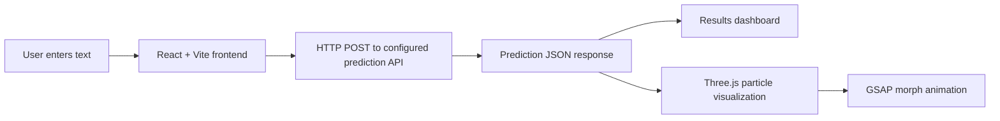

# BOT OR NOT — AI-Generated Text Detection

An interactive web interface for exploring whether a passage of text is more likely to be **human-written** or **AI-generated**. BOT OR NOT combines a text-classification API with a real-time, animated 3D particle visualization and a detailed prediction dashboard.

> **Project status:** Frontend source is available in this repository. The model training pipeline and inference backend are maintained separately and are **not included here**. The previously linked Vercel deployment was unavailable during the November 2026 review; a working demo URL should be added only after deployment is restored.

## What it does

- Accepts user-entered text and submits it to a classification API.
- Displays the predicted class along with confidence and class probabilities when the backend supplies them.
- Presents optional prediction details, including token counts, tokens, top tokens, and basic linguistic statistics when supplied by the backend.
- Animates **12,000 Three.js particles**, morphing a 3D sphere into the returned prediction label with **GSAP**.
- Provides a responsive results section for exploring the returned information.

## Demo

A live demo link will be restored here after deployment is verified. Until then, run the frontend locally using the instructions below and a working prediction API.

## Architecture



**Frontend:** React 19, Vite 8, JavaScript, CSS  
**Visualization:** Three.js, GSAP  
**Model/API:** An external inference service accessed through an environment-configured URL. The broader BOT OR NOT project used a fine-tuned DistilBERT text classifier, but model weights, training code, and evaluation artifacts are not contained in this frontend repository.

## Getting started

### Prerequisites

- Node.js and npm compatible with the versions specified in `package.json`
- A working HTTP prediction endpoint that accepts JSON

### 1. Clone and install

```bash
git clone https://github.com/HIRGON7/Bot-Or-Not.git
cd Bot-Or-Not
npm install
```

### 2. Configure the API endpoint

Create `.env.local` in the repository root:

```dotenv
VITE_API_URL=https://your-api.example.com/predict
```

**Important:** This value must be the **complete prediction endpoint URL**, not just the backend host. Variables beginning with `VITE_` are included in the client bundle; **never place private keys or credentials in them**.

### 3. Start the application

```bash
npm run dev
```

Open the local URL printed by Vite.

### Build and lint

```bash
npm run build
npm run lint
npm run preview
```

The current repository does not define an automated test command. Model inference will not work until a compatible API endpoint has been configured.

## API contract

The frontend sends an HTTP `POST` request with a JSON body:

```json
{
  "text": "Example passage for classification."
}
```

It reads the predicted class from one of the following response fields: `prediction`, `predicted_label`, `label`, or `result`.

The results page also recognizes these optional fields:

| Field | Meaning in the UI |
| --- | --- |
| `confidence` | Score displayed as a percentage |
| `ai_probability` | Score for the AI-generated class |
| `human_probability` | Score for the human-written class |
| `token_count` | Token count returned by the API |
| `explanation` | Explanatory text returned by the API |
| `linguistic_analysis` | Sentence, word, and unique-word counts |
| `tokens`, `top_tokens` | Token-based details, if available |

A response might look like this (**illustrative only**, not an actual model output):

```json
{
  "prediction": "human",
  "confidence": 0.82,
  "ai_probability": 0.18,
  "human_probability": 0.82,
  "token_count": 7
}
```

The interface currently interprets numeric scores between 0 and 1 as proportions and larger values as percentages. The backend should use a consistent format for all returned scores.

## Repository structure

```text
Bot-Or-Not/
├── public/                 # Static assets and icons
├── src/
│   ├── assets/             # Frontend imagery
│   ├── component/
│   │   └── morph.jsx       # Particle scene, animation, and API request
│   ├── styles/
│   │   └── Morph.css       # Input and visualization styling
│   ├── App.jsx             # Classification results interface
│   ├── App.css             # Dashboard styling
│   └── main.jsx            # React entry point
├── index.html
├── package.json
└── vite.config.js
```

## ML development and reproducibility

This repository is the **presentation and inference-client layer**, not a reproducible training repository. For a complete machine-learning portfolio entry, the associated model repository or model card should document:

- Dataset name, source, size, license, and text-cleaning process.
- Data splitting method and measures against data leakage.
- DistilBERT checkpoint, fine-tuning configuration, and random seed.
- Test-set accuracy, precision, recall, macro F1, and confusion matrix.
- Error analysis across text length, domain, paraphrasing, and different generators.
- Inference endpoint configuration and deployment instructions.

These details are intentionally not fabricated here.

## Responsible use and limitations

AI-text detectors are **probabilistic classifiers**, not definitive proof of authorship. Their performance may degrade on short passages, unfamiliar genres, non-native writing, edited AI-generated text, or model outputs unlike the training distribution. The displayed score is a model output and should not be assumed to represent calibrated certainty without separate validation.

**Do not use this system as the sole basis for academic misconduct accusations, hiring decisions, or other high-stakes judgments.** User-submitted text is sent to the configured inference service; privacy and retention practices depend on that service's implementation.

## Roadmap

- [ ] Restore a verified live deployment.
- [ ] Add public model documentation, test metrics, and a reproducible evaluation pipeline.
- [ ] Add frontend input validation and clearer API error states.
- [ ] Add accessibility improvements and reduced-motion support.
- [ ] Add unit and integration tests.
- [ ] Add a screenshot or short demo recording.

## Author

**Hadi Jawhari** — [GitHub: HIRGON7](https://github.com/HIRGON7)

---

*BOT OR NOT is a software/ML demonstration project. The text classification output is informational and may be incorrect.*
